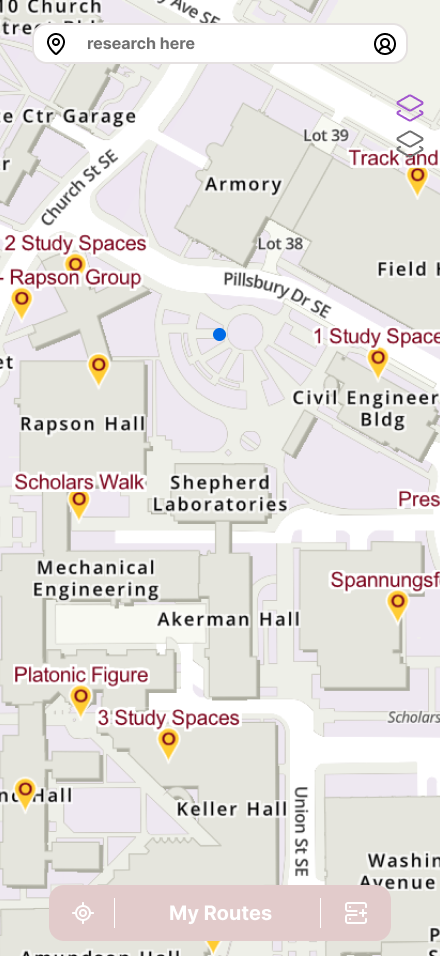

# Module 2 Group Assignment

CSCI 5117, Fall 2026, [assignment description](https://canvas.umn.edu/courses/579310/pages/project-2)

## App Info:

* Team Name: Peter Parkers
* App Name: TODO
* App Link: <https://TODO.com/>

### Students

* Jeonghyo Kim, kim02607
* Kelvin Pang, pang0161
* Salman Hussein, husse347
* Xuan Gu, ehrma055
* Donald Huynh, huynh338@umn.edu

## Key Features

**Describe the most challenging features you implemented
(one sentence per bullet, maximum 4 bullets):**

* ...

Which (if any) device integration(s) does your app support?

* ...

Which (if any) progressive web app feature(s) does your app support?

* ...

## Mockup images

**[Add images/photos that show your mockup](https://stackoverflow.com/questions/10189356/how-to-add-screenshot-to-readmes-in-github-repository) along with a very brief caption:**
Figma URL: https://www.figma.com/design/dGDN741uqPiwR2stjfaqAN/Project-2?node-id=0-1&p=f&t=Fnax9JvoRUuQDpRU-0

Here's the landing page for the site. You'll have to log in or sign up to see inside...

On logging in, the focus should be on the map, this is just a place holder, but by default paths should be visible.  

Simple search and routing should be available, the difficulty is in figuring when leaving the tunnels are available.  

A closer look at some buildings should really allow the user to really see the gopher way. Selecting a building should give us more options, allowing us to filter by floor to specifically which section of the gopher way is available to which floor.  

Dropped pins should be savable for users. This seems to be a pretty simple feature, and to expand on this we could allow for creating different lists, associating times to pins for class and maybe having push notifications towards that purpose.  

## Testing Notes

**Is there anything special we need to know in order to effectively test your app? (optional):**

* ...

## Screenshots of Site (complete)

**[Add a screenshot of each key page](https://stackoverflow.com/questions/10189356/how-to-add-screenshot-to-readmes-in-github-repository)
along with a very brief caption:**

## External Dependencies

**Document integrations with 3rd Party code or services here.
Please do not document required libraries (e.g., VUE, Firebase, vuefire).**

* Library or service name: description of use
* ...

**If there's anything else you would like to disclose about how your project
relied on external code, expertise, or anything else, please disclose that
here:**

...
